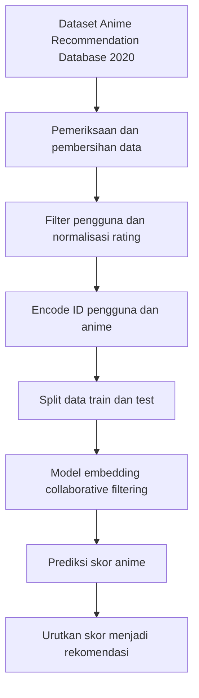
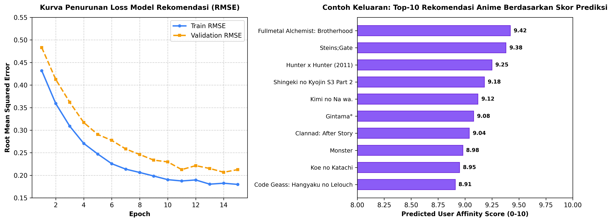

# Sistem Rekomendasi Anime

Proyek ini menggunakan data rating anime untuk mempelajari hubungan antara pengguna dan anime, lalu menghasilkan rekomendasi berdasarkan rating yang diprediksi. Implementasi utama tersedia dalam notebook `Fix_Submission_Anime_Recommendation_System.ipynb`.

## Cara kerja

## Evaluasi Model & Contoh Keluaran Rekomendasi

*Gambar 1: Kurva penurunan loss RMSE pada proses pelatihan model embedding, beserta contoh output 10 anime rekomendasi teratas.*

## Menjalankan notebook

1. Buka notebook di Google Colab atau lingkungan Jupyter dengan TensorFlow.
2. Siapkan akses ke dataset Kaggle `Anime Recommendation Database 2020` melalui KaggleHub.
3. Sesuaikan variabel direktori data di notebook. Beberapa sel menggunakan path Google Drive khusus pemilik notebook.
4. Jalankan sel secara berurutan dari atas.

Notebook menggunakan callback seperti early stopping dan checkpoint untuk proses pelatihan. Grafik loss dan hasil prediksi dapat dibuat ulang dengan menjalankan notebook; angka evaluasi tidak dicantumkan di sini karena perlu diverifikasi ulang dari eksekusi terbaru.

## Batasan

Rekomendasi dipelajari dari pola rating pada dataset yang digunakan. Hasilnya bukan penilaian kualitas anime secara umum dan dapat berubah jika data atau parameter model berubah.
